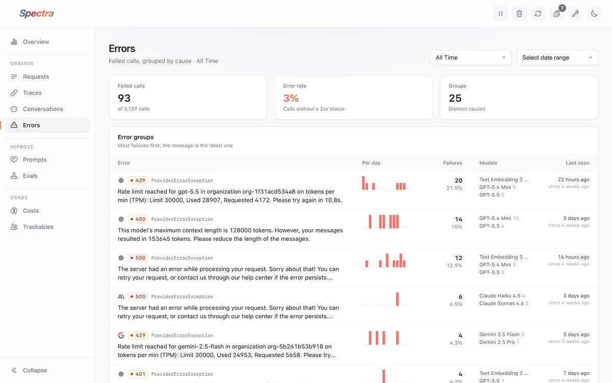
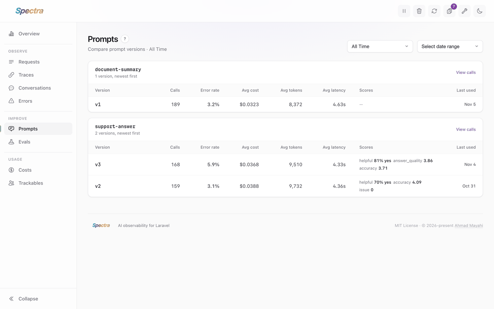
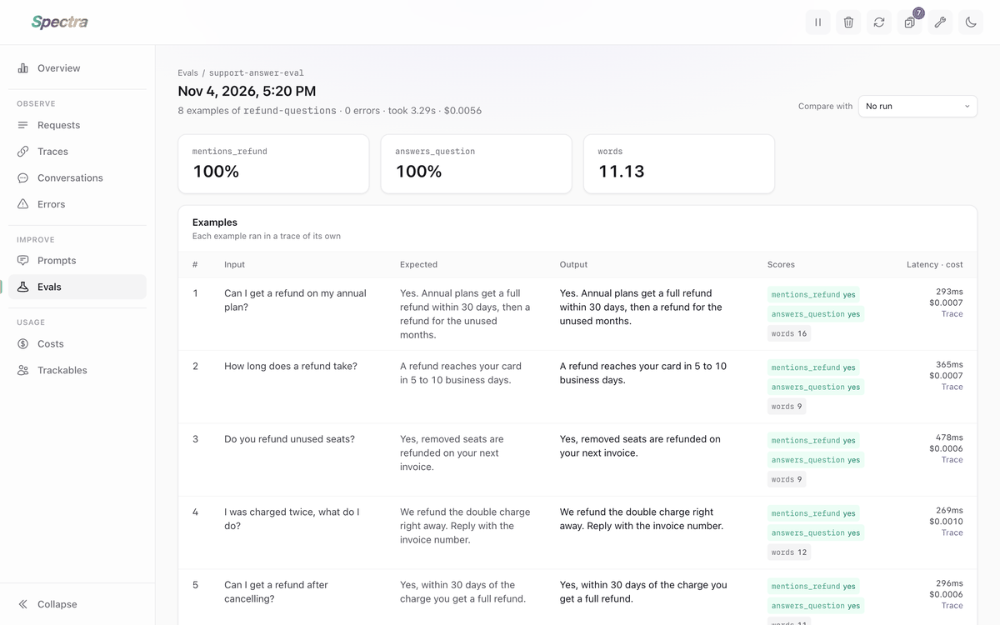
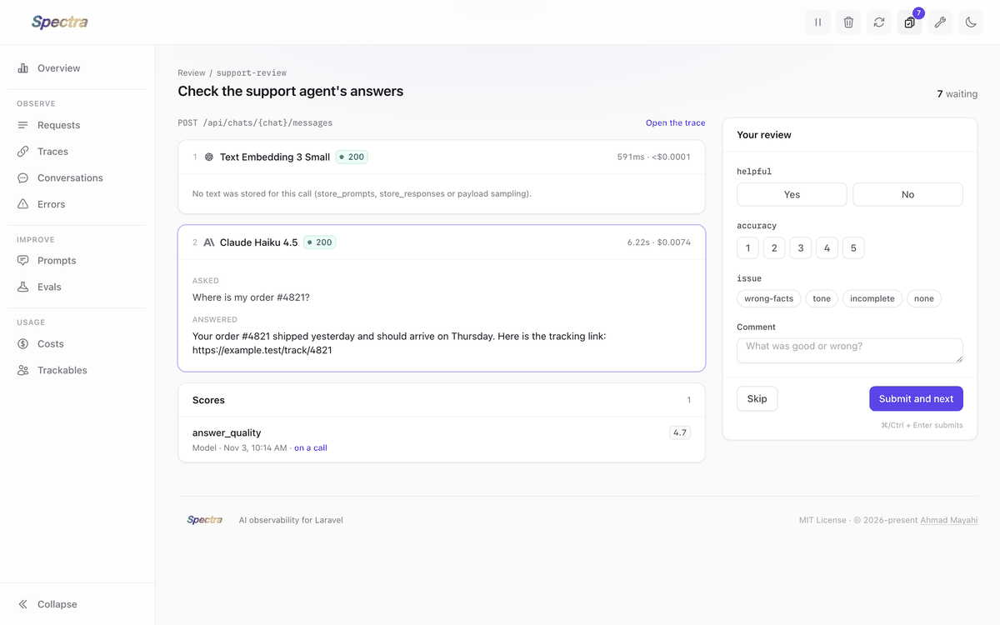

  

Spectra is an AI observability package for Laravel, built to track AI requests, measure usage, calculate costs across different pricing units, enforce budgets, and inspect AI operations through a unified dashboard and API. This lets you focus on shipping reliable AI features without getting buried in provider-specific operational complexity.

  <picture>
    <source media="(prefers-color-scheme: dark)" srcset="docs/public/images/dashboard/overview-dark.png" />
    
  </picture>

<table>
  <tr>
    <td width="50%">
      
      
<strong>Requests</strong> Usage, cost and latency per call

    </td>
    <td width="50%">
      
      
<strong>Request details</strong> Trace, tokens, cache hits and payload

    </td>
  </tr>
  <tr>
    <td width="50%">
      
      
<strong>Traces</strong> AI calls grouped by request or job

    </td>
    <td width="50%">
      
      
<strong>Trace timeline</strong> Calls, spans and tools in order

    </td>
  </tr>
  <tr>
    <td width="50%">
      
      
<strong>Conversations</strong> Multi-turn chats and their cost

    </td>
    <td width="50%">
      
      
<strong>Conversation transcript</strong> Each turn and its running cost

    </td>
  </tr>
  <tr>
    <td width="50%">
      
      
<strong>Errors</strong> Failed calls grouped by cause

    </td>
    <td width="50%">
      
      
<strong>Prompts</strong> Cost, latency and scores per version

    </td>
  </tr>
  <tr>
    <td width="50%">
      
      
<strong>Evals</strong> Datasets, runs and comparisons

    </td>
    <td width="50%">
      
      
<strong>Review</strong> Label traces by hand

    </td>
  </tr>
  <tr>
    <td width="50%">
      
      
<strong>Costs</strong> Spend by provider, model and user

    </td>
    <td width="50%">
      
      
<strong>Trackables</strong> Spend per user or team

    </td>
  </tr>
  <tr>
    <td width="50%">
      
      
<strong>Trackable details</strong> One user's spend and requests

    </td>
    <td width="50%">
      
      
<strong>Dark mode</strong> Follows your system theme

    </td>
  </tr>
</table>

  

## Official Documentation

Official documentation can be found on [spectraphp.com](https://spectraphp.com).

## Upgrading to 4.0

Spectra 4.0 adds scores, alerts, redaction, payload sampling, prompt versions, tool spans, error grouping, review queues, evaluations and a maintenance screen. Most apps only need to run `php artisan spectra:install` once. Check the guide if `spectra:install` runs in a deploy script, if others use your dashboard in production, or if your code reads `RequestContext::$id`. See the [upgrade guide](UPGRADE.md) and the [changelog](CHANGELOG.md).

## Code of Conduct

While this project is not affiliated with Laravel, we follow the Laravel [Code of Conduct](https://laravel.com/docs/contributions#code-of-conduct). We expect all contributors to follow these guidelines.

## Author

This library is created by [Ahmad Mayahi](https://mayahi.net) with contributions from the [Open Source Community](https://github.com/spectra-php/laravel-spectra/graphs/contributors).

## License

The MIT License (MIT). Please see [License File](LICENSE) for more information.
