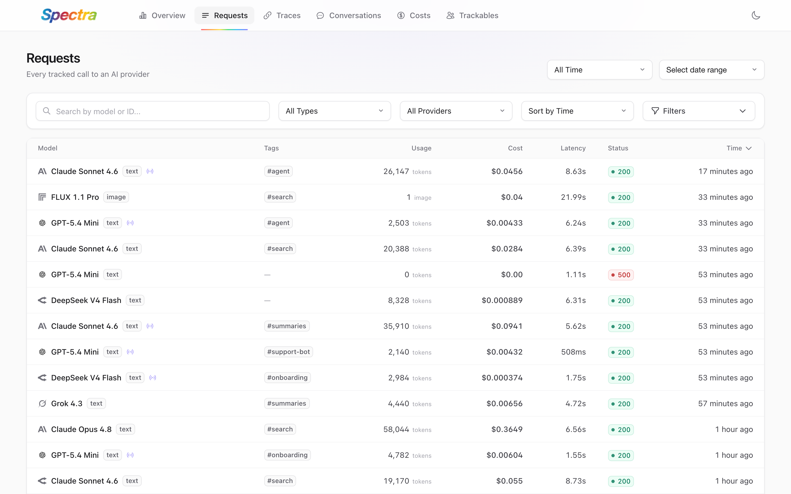
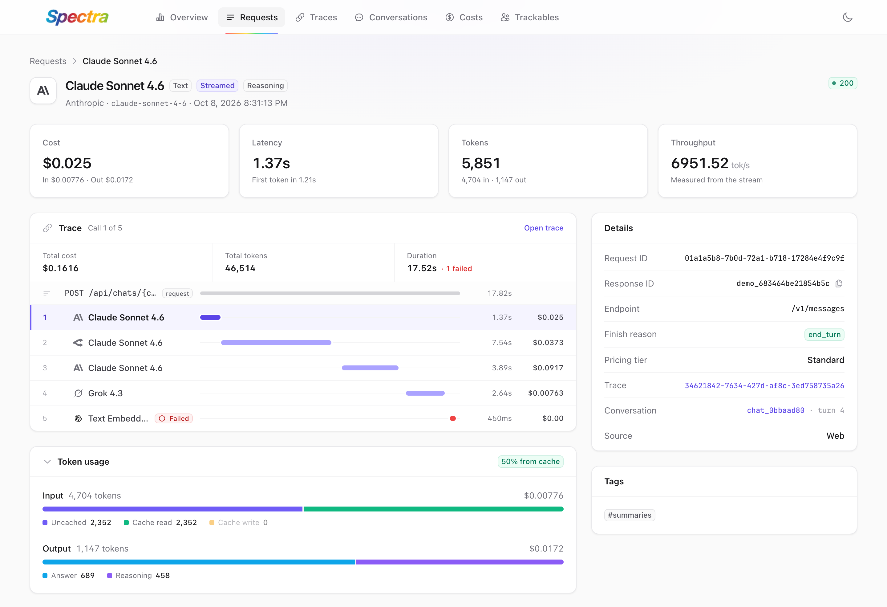
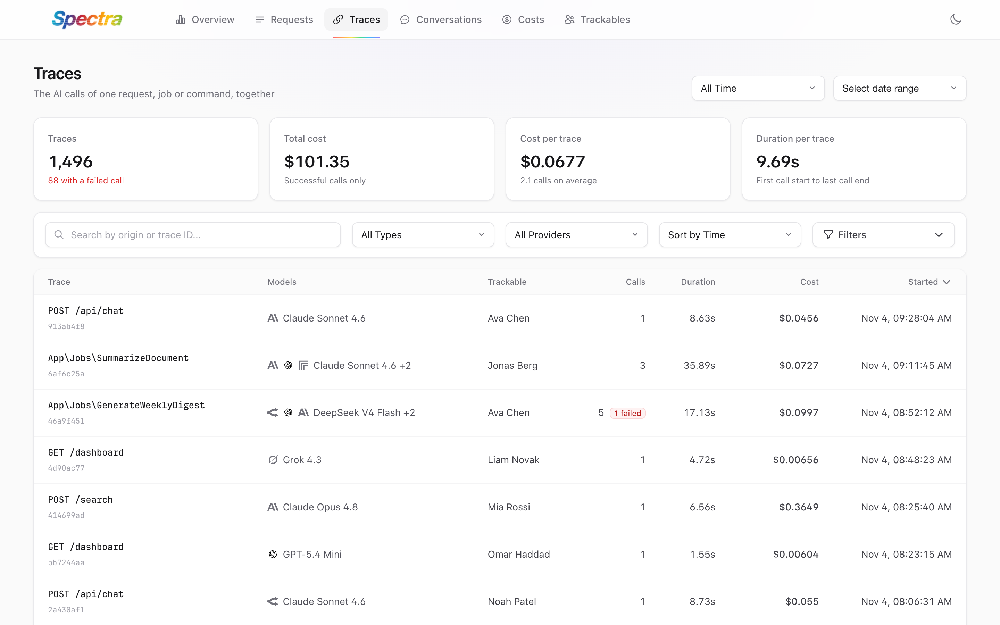
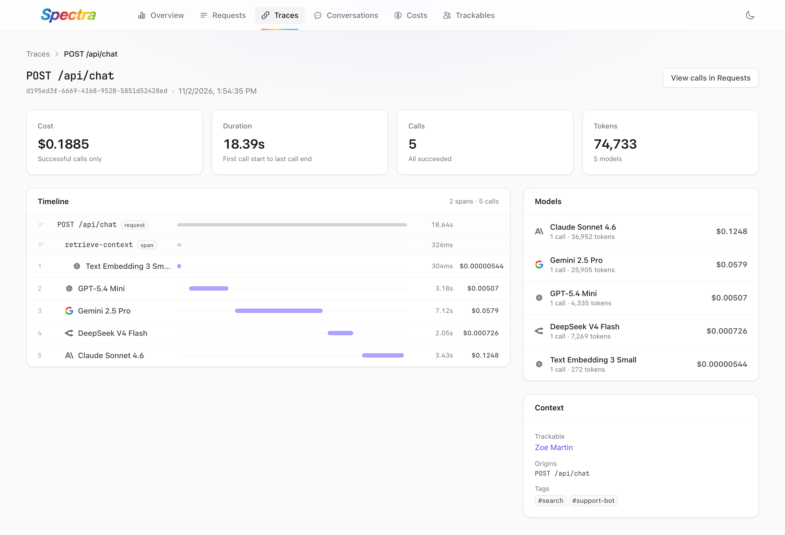
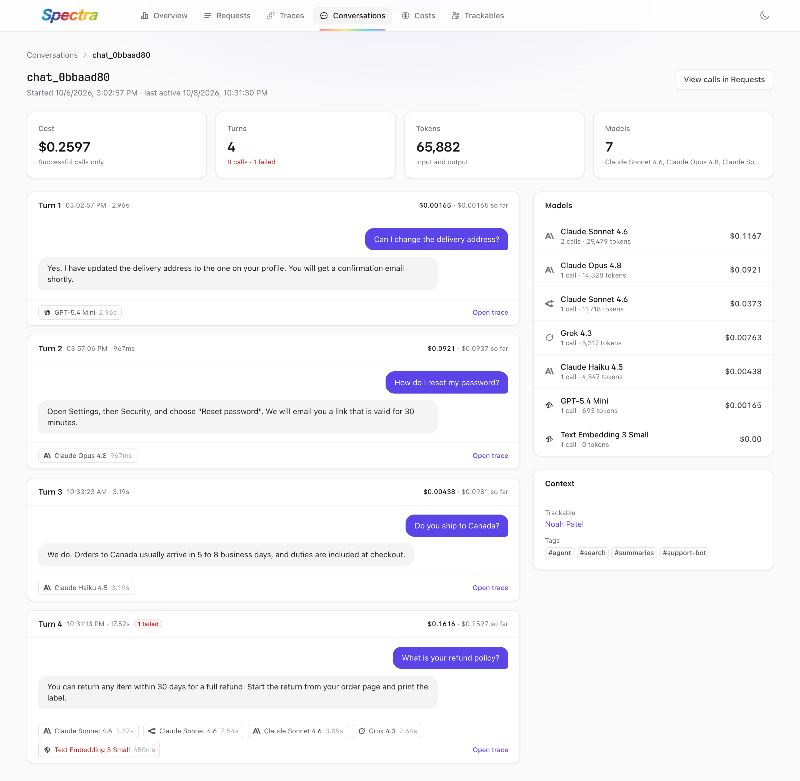
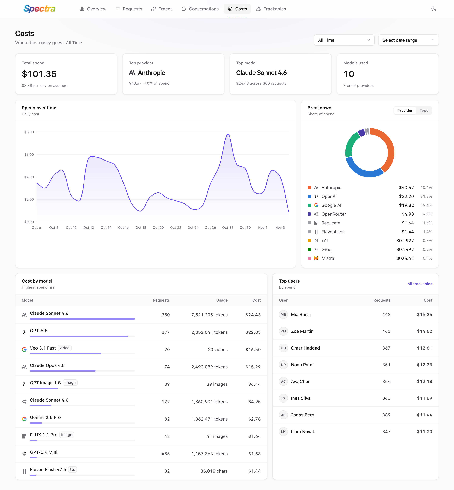
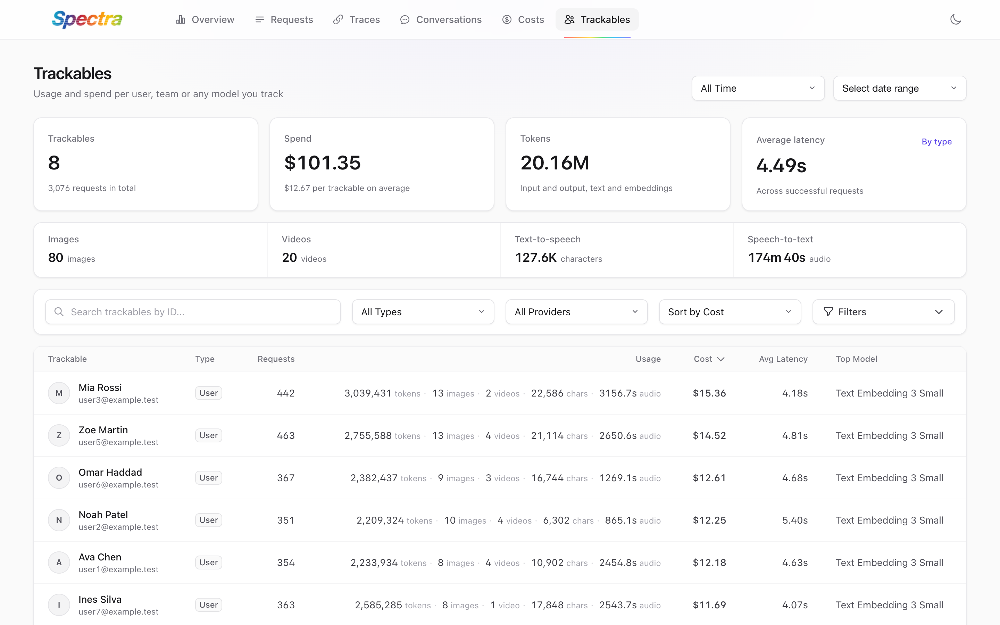
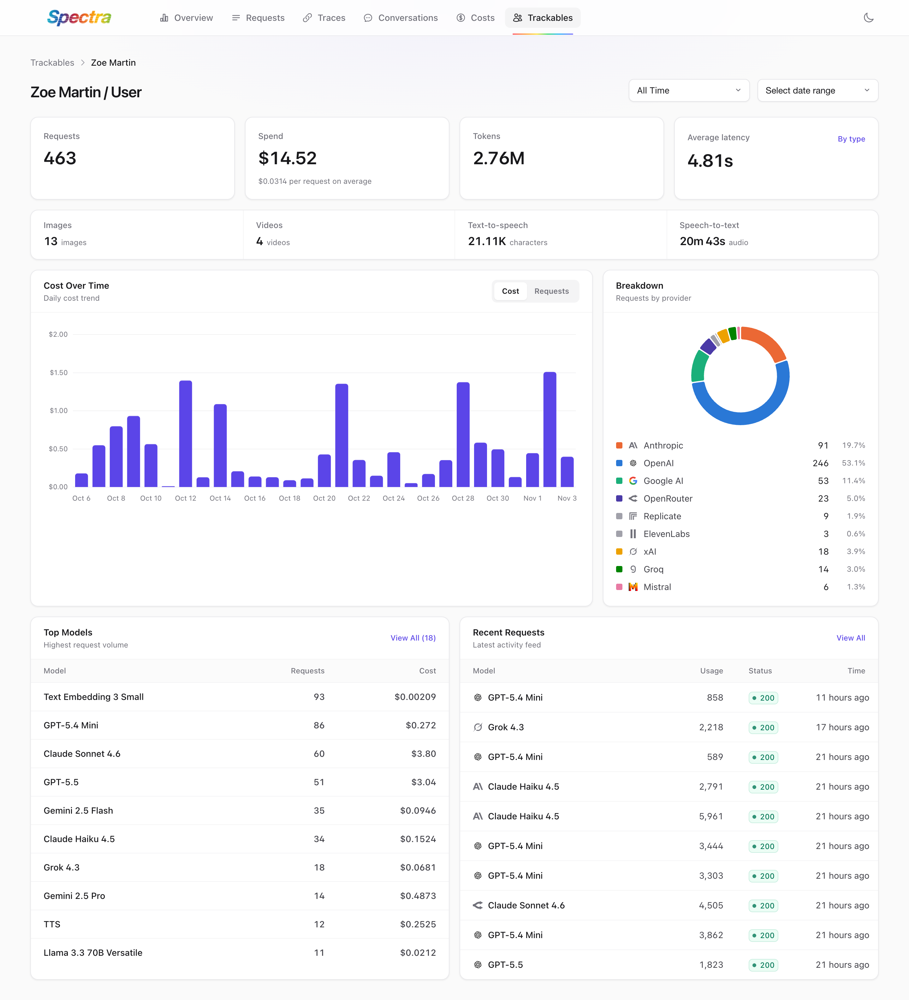
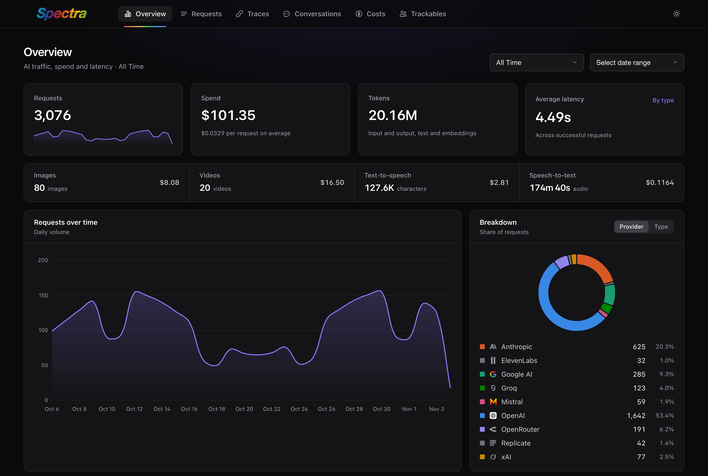

  

Spectra is a comprehensive Laravel package for AI observability. It helps you track AI requests, measure usage, calculate costs across different pricing units, enforce budgets, and inspect AI operations through a unified dashboard and API. This lets you focus on shipping reliable AI features without getting buried in provider-specific operational complexity.

  <picture>
    <source media="(prefers-color-scheme: dark)" srcset="docs/public/images/dashboard/overview-dark.png" />
    
  </picture>

  

## Dashboard

Spectra ships with a dashboard at `/spectra`. Every screen can be narrowed to a period or a date range, and the lists filter by type, provider, tag and more. Click a screenshot to see it at full size.

<table>
  <tr>
    <td width="50%" valign="top">
      
      
<strong>Requests</strong> Every AI call your app makes, with its model, tags, usage, cost, latency and status. Search by model or ID, and filter by type, provider, tag or finish reason.

    </td>
    <td width="50%" valign="top">
      
      
<strong>Request details</strong> Cost split into input and output, latency and time to first token, and the tokens broken down into uncached, cache reads, cache writes and reasoning. Shows the trace the call belongs to and the raw request and response.

    </td>
  </tr>
  <tr>
    <td width="50%" valign="top">
      
      
<strong>Traces</strong> The AI calls of one HTTP request, queued job or Artisan command, grouped together. See where each trace came from, which models it used, how long it took and what it cost.

    </td>
    <td width="50%" valign="top">
      
      
<strong>Trace timeline</strong> Every call of a trace on one timeline, to the millisecond, nested under the spans you open with <code>Spectra::span()</code>. The side panel shows the cost and tokens per model.

    </td>
  </tr>
  <tr>
    <td width="50%" valign="top">
      
      
<strong>Conversations</strong> Multi-turn chats, one row per conversation, with their turns, models, user, cost and last activity.

    </td>
    <td width="50%" valign="top">
      
      
<strong>Conversation transcript</strong> Read a conversation turn by turn: the user's message, the model's reply, the calls each turn made, what the turn cost and what the conversation has cost so far.

    </td>
  </tr>
  <tr>
    <td width="50%" valign="top">
      
      
<strong>Costs</strong> Where the money goes: daily spend, the share of each provider or model type, cost per model with its usage in tokens, images, videos or characters, and the users who spend the most.

    </td>
    <td width="50%" valign="top">
      
      
<strong>Trackables</strong> Usage and spend per user, team or any Eloquent model you attribute requests to: requests, tokens, media, cost, latency and their most used model.

    </td>
  </tr>
  <tr>
    <td width="50%" valign="top">
      
      
<strong>Trackable details</strong> One user's spend over time, the providers and models they use, and their latest requests.

    </td>
    <td width="50%" valign="top">
      
      
<strong>Dark mode</strong> The dashboard follows your system theme, and the toggle in the top bar switches it.

    </td>
  </tr>
</table>

## Official Documentation

Official documentation can be found on [spectraphp.com](https://spectraphp.com).

## Upgrading to 2.0

Spectra 2.0 tracks streamed responses automatically, bills prompt-cache reads and writes and reasoning tokens for every provider, and updates every pricing catalog. Most apps only need to run one new migration. See the [upgrade guide](UPGRADE.md) and the [changelog](CHANGELOG.md).

## Code of Conduct

While this project is not affiliated with Laravel, we follow the Laravel [Code of Conduct](https://laravel.com/docs/contributions#code-of-conduct). We expect all contributors to follow these guidelines.

## Author

This library is created by [Ahmad Mayahi](https://mayahi.net) with contributions from the [Open Source Community](https://github.com/spectra-php/laravel-spectra/graphs/contributors).

## License

The MIT License (MIT). Please see [License File](LICENSE) for more information.
