

  

Spectra is an AI observability package for Laravel, built to track AI requests, measure usage, calculate costs across different pricing units, enforce budgets, and inspect AI operations through a unified dashboard and API. This lets you focus on shipping reliable AI features without getting buried in provider-specific operational complexity.

  <picture>
    <source media="(prefers-color-scheme: dark)" srcset="docs/public/images/dashboard/overview-dark.png" />
    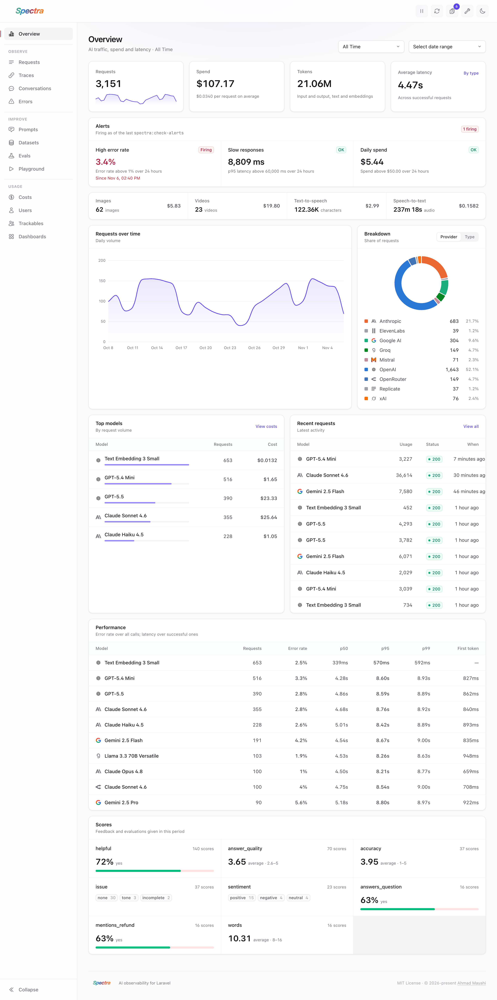
  </picture>

<table>
  <tr>
    <td width="50%">
      <a href="https://raw.githubusercontent.com/spectra-php/laravel-spectra/refs/heads/main/docs/public/images/dashboard/requests.png" target="_blank" rel="noopener">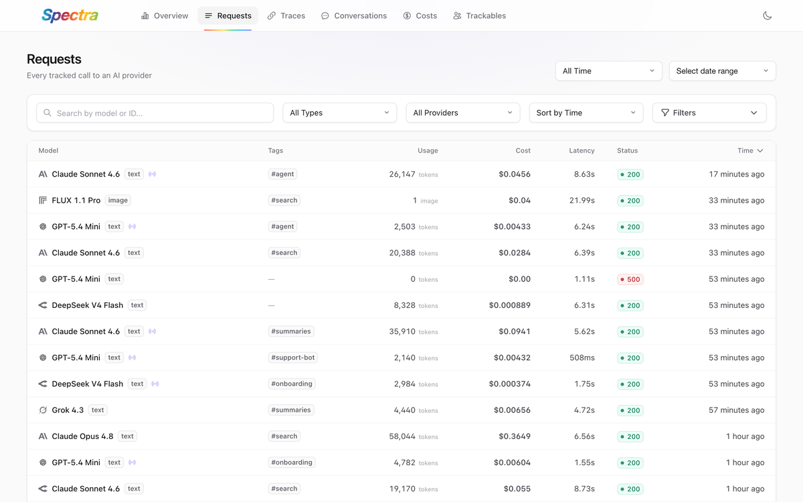</a>
      
<strong>Requests</strong> Every AI call with its usage, cost and latency

    </td>
    <td width="50%">
      <a href="https://raw.githubusercontent.com/spectra-php/laravel-spectra/refs/heads/main/docs/public/images/dashboard/request-detail.png" target="_blank" rel="noopener">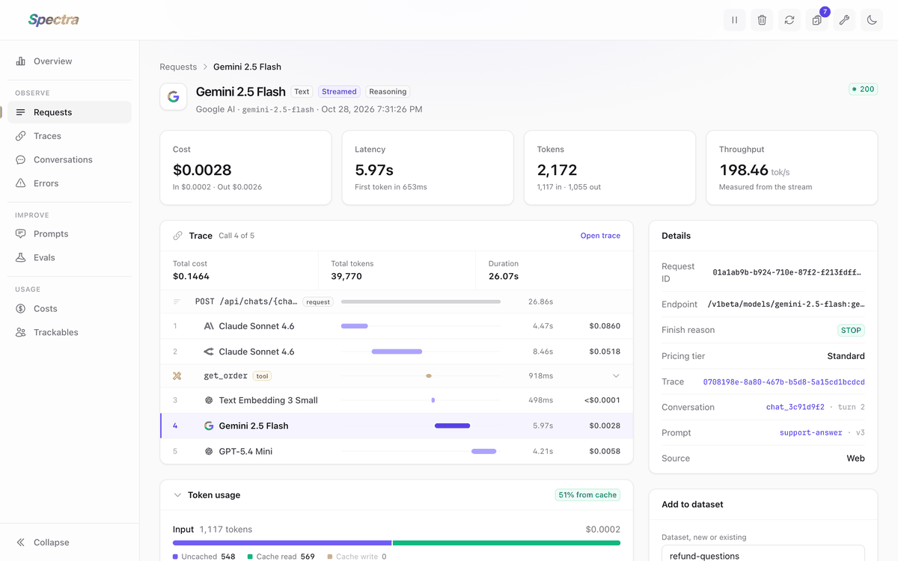</a>
      
<strong>Request details</strong> Token breakdown, cache hits, cost split and payload

    </td>
  </tr>
  <tr>
    <td width="50%">
      <a href="https://raw.githubusercontent.com/spectra-php/laravel-spectra/refs/heads/main/docs/public/images/dashboard/traces.png" target="_blank" rel="noopener">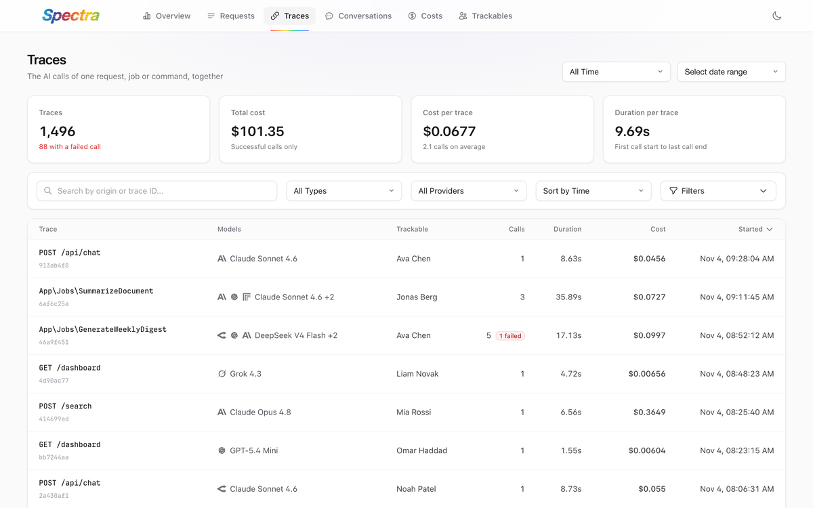</a>
      
<strong>Traces</strong> The AI calls of one request, job or command

    </td>
    <td width="50%">
      <a href="https://raw.githubusercontent.com/spectra-php/laravel-spectra/refs/heads/main/docs/public/images/dashboard/trace-detail.png" target="_blank" rel="noopener">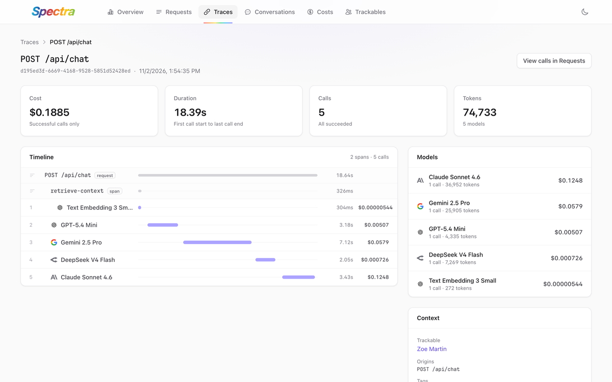</a>
      
<strong>Trace timeline</strong> Every call and span on one timeline

    </td>
  </tr>
  <tr>
    <td width="50%">
      <a href="https://raw.githubusercontent.com/spectra-php/laravel-spectra/refs/heads/main/docs/public/images/dashboard/conversations.png" target="_blank" rel="noopener">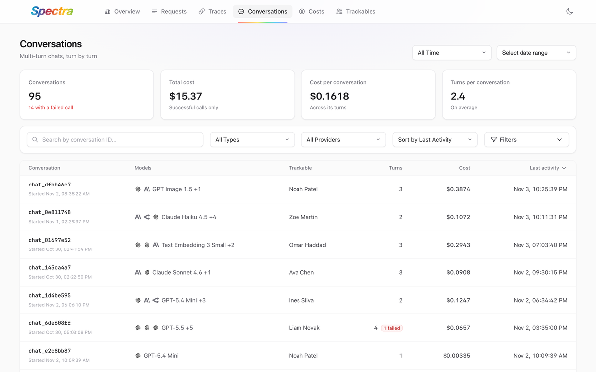</a>
      
<strong>Conversations</strong> Multi-turn chats with their turns and cost

    </td>
    <td width="50%">
      <a href="https://raw.githubusercontent.com/spectra-php/laravel-spectra/refs/heads/main/docs/public/images/dashboard/conversation-detail.png" target="_blank" rel="noopener">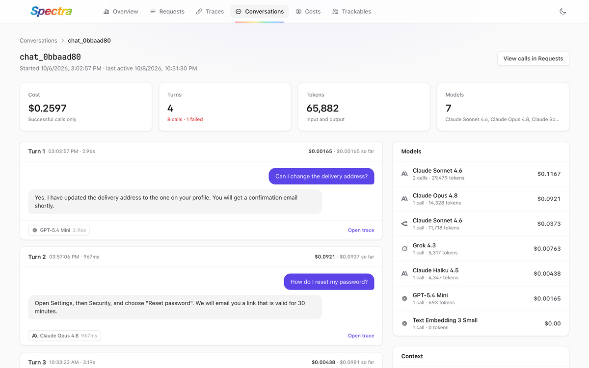</a>
      
<strong>Conversation transcript</strong> Each turn with its messages and running cost

    </td>
  </tr>
  <tr>
    <td width="50%">
      <a href="https://raw.githubusercontent.com/spectra-php/laravel-spectra/refs/heads/main/docs/public/images/dashboard/costs.png" target="_blank" rel="noopener">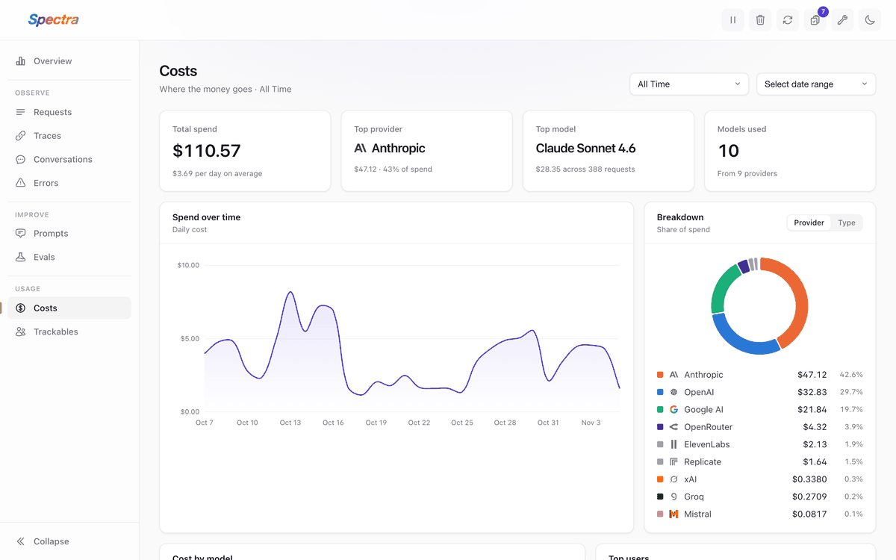</a>
      
<strong>Costs</strong> Spend over time, by provider, model and user

    </td>
    <td width="50%">
      <a href="https://raw.githubusercontent.com/spectra-php/laravel-spectra/refs/heads/main/docs/public/images/dashboard/trackables.png" target="_blank" rel="noopener">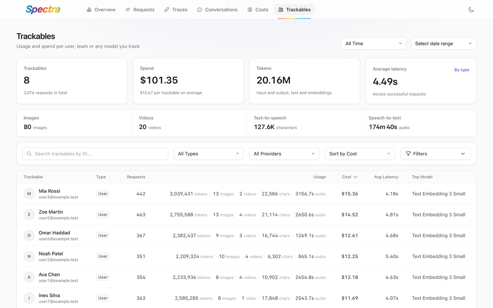</a>
      
<strong>Trackables</strong> Usage and spend per user, team or any model

    </td>
  </tr>
  <tr>
    <td width="50%">
      <a href="https://raw.githubusercontent.com/spectra-php/laravel-spectra/refs/heads/main/docs/public/images/dashboard/trackable-detail.png" target="_blank" rel="noopener">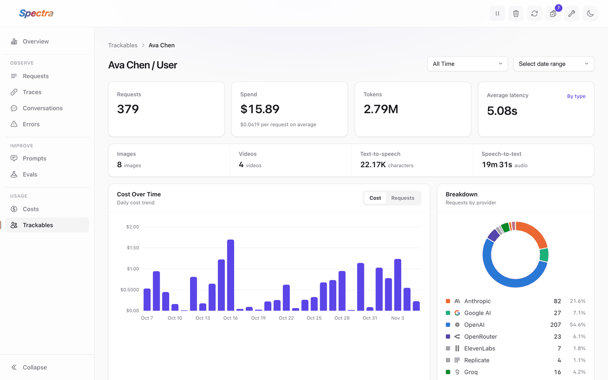</a>
      
<strong>Trackable details</strong> One user's spend, models and latest requests

    </td>
    <td width="50%">
      <a href="https://raw.githubusercontent.com/spectra-php/laravel-spectra/refs/heads/main/docs/public/images/dashboard/overview-dark.png" target="_blank" rel="noopener">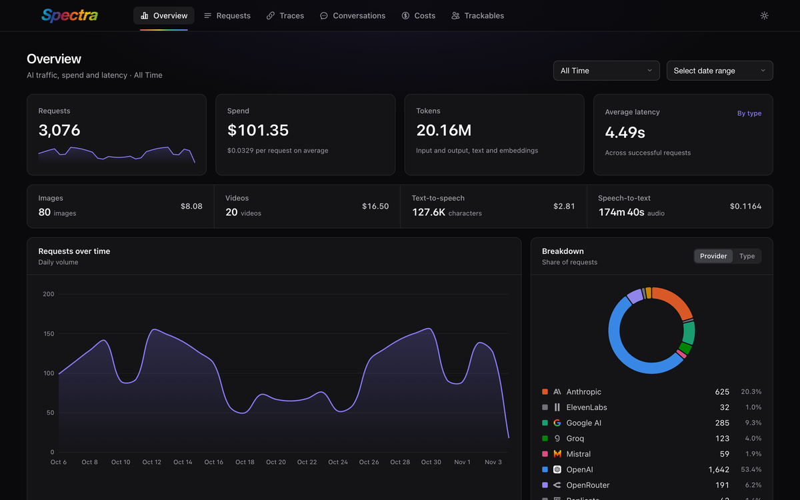</a>
      
<strong>Dark mode</strong> Follows your system theme, or toggle it

    </td>
  </tr>
</table>

  

## Official Documentation

Official documentation can be found on [spectraphp.com](https://spectraphp.com).

## Upgrading to 3.0

Spectra 3.0 adds traces, spans and conversations, and fixes several billing and budget bugs. Most apps only need to run `php artisan spectra:install` once. Check the guide if you use budgets, remove built-in providers in your published config, or touch `RequestContext` in your code. See the [upgrade guide](UPGRADE.md) and the [changelog](CHANGELOG.md).

## Code of Conduct

While this project is not affiliated with Laravel, we follow the Laravel [Code of Conduct](https://laravel.com/docs/contributions#code-of-conduct). We expect all contributors to follow these guidelines.

## Author

This library is created by [Ahmad Mayahi](https://mayahi.net) with contributions from the [Open Source Community](https://github.com/spectra-php/laravel-spectra/graphs/contributors).

## License

The MIT License (MIT). Please see [License File](LICENSE) for more information.
